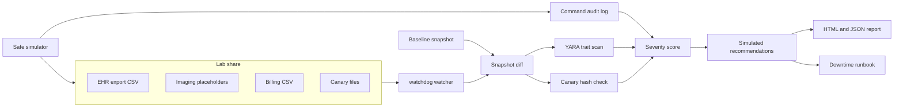

# Hospital ransomware detector

A local lab tool that watches a fake hospital file share and raises an alert when the activity looks like ransomware. It is a portfolio project for learning and demonstration. It is not an endpoint product, and it does not protect a live clinic by itself.

Project owner: Sangeeta Sinha, VigilAI Solutions. Certifications: CompTIA Security+, CompTIA CySA+, EC-Council CEH. Background in healthcare operations.

The share is synthetic. Patient names are "Example Person", ids start with `SYN`, and there is no real health information. The repository does not contain malware and does not download any.

## What it checks

Three things feed one score.

1. **YARA traits.** `rules/hospital_ransomware_traits.yar` matches a cluster of ransom-note phrases, and a short list of extensions that have appeared in public ransomware reports (`.locked`, `.encrypted`, `.crypt`, `.crypto`, `.ryk`, `.wncry`). A match is a naming or wording trait. It is not identification of a malware family. The samples under `samples/` are text files written for this rule. Two phrases are not enough to match. Ordinary notes about disk encryption do not match.

2. **File behavior.** A snapshot of the share is compared with a baseline. The watcher (`watchdog`) decides when to look again. The decision itself is the diff, so a burst of file events only affects timing.
   - A known low-entropy file replaced by a high-entropy file counts as an entropy jump. Shannon entropy is the measure. Text exports in this lab sit around 4–5. The simulator's output sits around 7.9.
   - A new extension from the list above counts as a suspicious rename. One or two files score less than a burst of five.
   - New files that are byte-for-byte copies of files already on the share count as a backup, even if the folder is not named "backup".
   - New high-entropy files that do not replace a known record (a zip dropped into a folder, for example) are not scored. Folder names are not trusted either way: a directory called `Backups` full of `.locked` replacements still alerts.
   - Canary files sit in the EHR export, imaging, and billing folders and look like the other files. Their hashes live **outside** the share. If a canary is edited, renamed, or removed, that is an alert. A person saving the file causes the same alert.
   - Command text is checked for a few recovery-suppression lines seen in public incident write-ups, including `vssadmin delete shadows`. `vssadmin list shadows` does not match. A match means the text was present. This program does not know if anyone ran it, and it never runs it.

3. **A simulated response and a downtime runbook.** The score becomes a severity. High and critical reports recommend isolating a host and suspending the process that is writing the files. Those are recommendations. The report's action list is empty on purpose. The longer checklist is `runbooks/hospital_ransomware_downtime.md`. It starts with how to keep care going (downtime forms, read-back, pharmacy, who not to reboot) and then covers containment, backups, and notification. Notification decisions, including anything under the HIPAA Breach Notification Rule, are left to the privacy officer and counsel.

## How to run

Linux or macOS, Python 3.11 or newer. The commands below were run on Linux.

```bash
python3 -m venv .venv
source .venv/bin/activate
pip install -e ".[dev]"

vigil-detect demo
vigil-detect check-backup
pytest
```

`vigil-detect demo` creates `./lab-data`, seeds a synthetic share, starts the watcher, and runs the safe simulator. A critical alert and an HTML report should show up within a few seconds. Open `lab-data/reports/incident-report.html`.

`vigil-detect check-backup` copies those files into a `Backups` folder, leaves the originals alone, and should print severity `info` with score 0.

`pytest` covers both of those outcomes, plus calm rewrites, new zip files, a canary edited by itself, YARA true and false matches, and the simulator's refusal to leave its lab folder.

To put the lab files back after a demo:

```bash
vigil-detect restore --share lab-data/share
```

Other commands: `seed`, `baseline`, `simulate`, `analyze`, `watch`, and `scan-rules`. `vigil-detect --help` lists them.

## Architecture



The watcher does not score events one by one. It waits for a short quiet period, then reads the share again. Copies, rewrites, and encryption are decided from hashes, entropy, and extensions.

## How the score is built

Defaults live in `DetectorConfig` and `Weights`. They are sized for this small lab share. They are not false-positive rates from a hospital network.

| What happened | Points | Severity you should expect |
| --- | ---: | --- |
| Canary modified or missing | 60 | High if nothing else is wrong. Critical if files are also being replaced or a suppression command is present. |
| Shadow-copy or recovery-suppression text | 35 | High on its own. Critical together with a file burst. |
| Entropy jump | 10 each, capped at 30 | High once three or more files jump. |
| Suspicious extension | 10 below five files, 25 at five or more | High for a burst. Critical if an entropy burst is also present. |
| Ransom-note YARA rule | 25 | Medium on its own. |
| Extension YARA rule | 10, or 0 if the rename signal already counted it | Recorded either way so the match is visible. |
| Bulk copy, calm rewrite, or new archives | 0 | Info. No containment recommendation. |

One encrypted file is a medium alert. The demo encrypts the whole share, so it lands on critical (score 175 with the current weights: 60 + 35 + 30 + 25 + 25).

## Design choices

- **Care is listed before cleanup.** In a hospital the first question is how the current patients will be looked after. The runbook says that, and it tells you to follow the facility's own downtime policy when the two differ. The report also says a file alert does not, by itself, mean the record system is down.
- **Backups are recognized by bytes, not by folder name.** A nightly copy has the same hash as the original. Encryption does not. A zip is high entropy from the moment it is created, so entropy counts only when a file this tool has already seen goes from low to high.
- **Canaries are boring on purpose.** They use the same kind of names as the exports. The manifest is stored next to the share, not in it, so a process that only rewrites the share does not erase the hashes.
- **The simulator is reversible and walled in.** It will not run unless the share contains `VIGIL_LAB_SHARE.txt` with the phrase "Synthetic hospital file-share lab". It refuses the filesystem root, a home directory, a project directory, symlinks, and Python source files. It only rewrites `.csv`, `.txt`, and `.tsv` files, and it skips the marker. The transform is a public header plus XOR with a keystream from Python's `random.Random` and a fixed seed (`0x56494749`). That is deliberately not strong cryptography: anyone can restore the files, which is the point. The audit line that mentions `vssadmin delete shadows` is marked `executed=false`. Nothing is passed to a shell.
- **The report is one HTML file with no network calls**, plus JSON for anything that wants to read the same result. Recommendations and the downtime list are in the page. "Actions this program took" stays empty.
- **Thresholds are conservative for a clinic drill.** A single odd file should not page the hospital. A canary plus encryption should.

## Tests

`pytest` is the check. The cases that matter most:

- The demo watcher reaches **critical** on the simulator, with canary, entropy, rename, YARA, and the command-text signal, and it does so in a few seconds.
- A bulk copy, including copies of the canaries, stays at **info** and score 0.
- New random `.zip` files are not scored.
- Replacing real files inside a folder named `Backups` is still critical.
- Rewriting exports without an entropy jump is info.
- Editing one canary is high, and the report says to confirm a person did not save it. It does not recommend isolating the clinical network.
- A ransom-note rule match on its own is medium and does not recommend containment.
- `vssadmin list shadows` does not match. The delete form does.
- The crafted YARA sample matches. The benign clinical notes do not. The rule file does not match itself.
- The simulator restores original bytes, leaves an unknown `.locked` file alone, and refuses symlinks and unmarked directories.

## Layout

```
rules/hospital_ransomware_traits.yar
runbooks/hospital_ransomware_downtime.md
samples/crafted_traits/          text written to exercise the note rule
samples/benign_clinical/         notes that should stay quiet
src/vigil_detect/                detector, watcher, simulator, report
tests/
```

`lab-data/` is created by the demo and is gitignored.

## Limitations

- Not tested on real ransomware, on purpose. A drill with this simulator is not a detection rate.
- Not a substitute for offline or immutable backups, application allowlisting, network segmentation, or an endpoint agent.
- It watches one folder on one machine. It does not read the Windows event log. Point `--audit` at a log you already collect if you want the command check outside this lab.
- Renames are paired in the same directory. A move to another folder plus encryption can be missed, except when the moved file is a canary (the canary path disappears, which still alerts).
- Entropy will not jump for a file that was already compressed or encrypted. Those files are a known gap. New archives are handled by not scoring them unless they replace a low-entropy file.
- The note rule is a handful of English phrases. Different wording will pass it. Copying the crafted sample into a watched share will trip it. That is what the rule is for.
- Quoting `vssadmin delete shadows` in a file the scanner reads will match, because this is a text search, not a shell parser.
- Canaries alert when a person edits them. That is a false positive you accept in exchange for noticing a quiet change.
- Thresholds will be wrong for a share with millions of files. They are not tuned on hospital traffic.
- This does not decide whether a HIPAA breach occurred, and it does not give clinical orders.

## License

MIT. Copyright 2026 Sangeeta Sinha.
